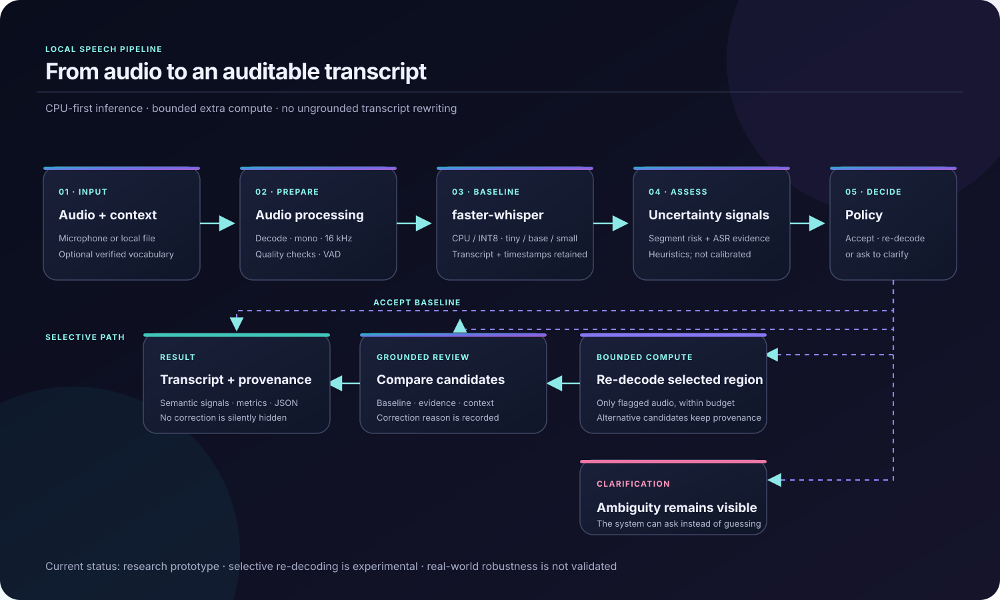

# EchoMind

**Local multilingual speech analysis with explainable, experimental selective re-decoding.**

EchoMind runs speech recognition on your machine and makes its decisions inspectable: baseline transcript, uncertainty signals, bounded re-decoding, timing, and correction provenance. It is a research and portfolio prototype—not a validated self-correcting product.

[Architecture](docs/assets/architecture.svg) · [Final validation](FINAL_VALIDATION.md) · [Project audit](PROJECT_AUDIT.md) · [Limitations](docs/limitations.md)

## What it does

- Transcribes local audio with faster-whisper on CPU using INT8 quantization.
- Accepts browser recordings and local audio files; supports English, French, and Modern Standard Arabic.
- Shows the baseline and final transcript, uncertainty timeline, latency, language, and structured JSON.
- Can selectively re-decode bounded regions and records why each candidate was accepted or rejected.
- Provides a FastAPI dashboard and an optional Gradio interface.
- Includes a CSV evaluation runner with raw and normalized WER/CER, latency, real-time factor, per-language summaries, and E0–E3 ablations.

Demo mode is simulated and exists to preview the interface. It is not an ASR result and is excluded from measured performance.

## Current evidence

The numbers below come from local faster-whisper runs on real audio. They are small research samples, not a general quality guarantee.

| Evaluation | Result | Interpretation |
| --- | --- | --- |
| FLEURS validation, 60 clean clips | **small:** 14.08% normalized WER, RTF 1.552; **base:** 28.07%, RTF 0.314 | Development/model-selection sample; small was more accurate and slower. |
| FLEURS Arabic validation, 20 paired clips | **small:** 27.59% normalized WER; **base:** 51.19% | Separate validation comparison, not test data. |
| FLEURS test, 60 clips, base E0→E3 | Normalized WER 28.20%→27.86%; normalized CER 10.67%→10.49% | One reference-scored correction improved and none worsened. It has not been confirmed by human listening. |

The test sample is clean read speech. Its export does not include individual speaker IDs, so person-level separation cannot be audited. Spontaneous speech, real code-switching, naturally noisy recordings, calibrated uncertainty, and human-reviewed correction quality are **not validated**. Arabic remains a quality gap. See [the complete validation record](FINAL_VALIDATION.md) for raw scores, latency, RTF, and the decision not to claim reliable self-correction.

## Architecture

The baseline transcript is preserved. Re-decoding is limited to selected regions, and the final decision remains auditable. Uncertainty values are heuristic unless a separately validated calibrator is used.

## Technology

| Area | Tools |
| --- | --- |
| Speech recognition | faster-whisper, CTranslate2, Whisper tiny / base / small |
| Runtime | Python 3.11+, CPU INT8 |
| API and dashboard | FastAPI, Uvicorn, HTML/CSS/JavaScript; optional Gradio |
| Audio and data | NumPy, SoundFile, SciPy; CSV/JSONL manifests |
| Evaluation | WER/CER, RTF, latency percentiles, E0–E3 ablations, pytest, Ruff |

## Run on Windows

PowerShell, from the project folder:

~~~powershell
py -3.11 -m venv .venv
.\.venv\Scripts\Activate.ps1
python -m pip install --upgrade pip
pip install -e ".[asr,ui,science,dev]"
python scripts/download_models.py --model tiny --download
~~~

The model download is a separate step because it retrieves model weights. To start the dashboard:

~~~powershell
python app.py
~~~

If Gradio is installed, the dashboard opens on port 7860. To run the FastAPI dashboard explicitly:

~~~powershell
python app.py --api --port 8000
~~~

Then open [http://127.0.0.1:8000/dashboard](http://127.0.0.1:8000/dashboard). Choose **Local ASR**, select or record audio, and run the analysis. Microphone access requires localhost or HTTPS. The browser sends the recording to the local EchoMind server; the application does not need a cloud API key.

## Evaluate

Create or download a local manifest as described in [the evaluation data guide](data/evaluation/README.md), then run:

~~~powershell
python scripts/evaluate.py data/evaluation/manifests/benchmark.csv --model base
python scripts/evaluate.py data/evaluation/manifests/benchmark.csv --model base --ablation
~~~

Reports written to experiments/reports/*.json, downloaded audio, model weights, and machine-specific CSV manifests are intentionally excluded from Git. Keep licensed source references and evaluation notes with the project; do not publish corpus audio unless its terms permit redistribution.

Run the automated suite and style checks:

~~~powershell
python -m pytest -q
ruff check src scripts tests
~~~

The suite tests the application logic and API with lightweight fixtures. Real-model metrics must come from an explicit run with downloaded weights; demo mode and mocked tests are not evidence of ASR accuracy.

## Repository map

- src/echomind/asr/ — audio loading and ASR adapters
- src/echomind/pipeline/ — uncertainty, policy, selective re-decoding, and orchestration
- src/echomind/api/ — FastAPI routes and browser dashboard
- src/echomind/ui/ — shared dashboard components and optional Gradio interface
- scripts/ — model preparation, corpus handling, evaluation, and demo utilities
- data/evaluation/ — data instructions, manifests, annotations, and local-only corpus files
- docs/ — architecture, methodology, data notes, evaluation, and limitations
- experiments/reports/ — curated Markdown summaries; generated JSON stays local

## License

EchoMind is released under the MIT License. Third-party datasets and model weights remain subject to their own licenses and terms.

