# Architecture

```mermaid
flowchart LR
  A[Local WAV/FLAC/OGG/MP3] --> B[Mono + 16 kHz preprocessing]
  B --> C[Energy VAD and segments]
  C --> D[Baseline faster-whisper]
  D --> E[Segment uncertainty features]
  E --> F{Budget policy}
  F -->|REDECODE| G[One bounded local alternative decode]
  G --> H[Grounded candidate reranker]
  F -->|ACCEPT| I[Semantic analysis]
  H --> I
  I --> J[Self-correction and ambiguity]
  J --> K[ACCEPT / REDECODE / CLARIFY]
  K --> L[Provenance-rich JSON + dashboard]
```

The baseline transcript is retained independently from the final transcript. A heuristic score is labelled `raw_score`; it is not a calibrated probability unless a separately fitted calibration model is supplied.
